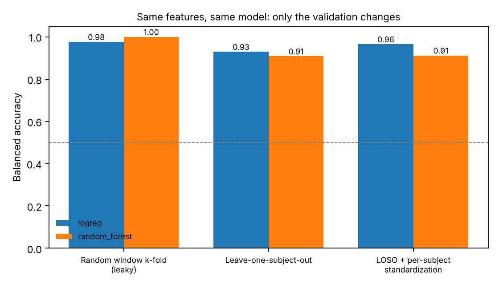
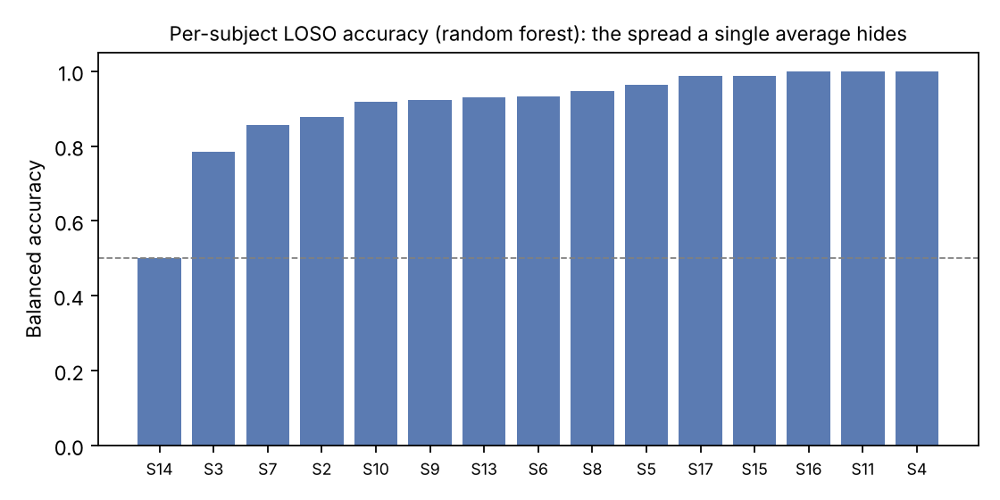

# Wearable stress detection: how much of the accuracy is real?

A reproducible validation audit of stress-vs-baseline classification on **WESAD** wrist signals
(Empatica E4: BVP, EDA, skin temperature, accelerometer).

The same features and the same models are evaluated three ways. Only the validation protocol changes:

| Protocol | What it tests | Typical failure it exposes |
|---|---|---|
| **Random window k-fold** | Windows shuffled across folds | Overlapping windows from the same person sit in both train and test. The model can memorise the person, not the stress response. |
| **Leave-one-subject-out (LOSO)** | Train on 14 people, test on an unseen one | This is the number that predicts performance on a new user. |
| **LOSO + per-subject standardization** | Each person's features standardized on their own data | Quantifies what a short per-user calibration period buys. It is a deployment assumption, not free accuracy. |

The pipeline also reports, for the random k-fold protocol, the **share of test windows that overlap in time with a training window from the same subject**. That single number is often enough to explain an inflated result.

## Run it

1. Download WESAD from its official page (University of Siegen, ~2 GB) and unzip it, so that `WESAD/S2/S2.pkl` … `WESAD/S17/S17.pkl` exist.
2. Install and run:

```bash
pip install -r requirements.txt
PYTHONPATH=src python -m wesad_audit.run --data /path/to/WESAD --out results
```

Defaults: 60 s windows, 5 s step, wrist signals only. Change them with `--win` and `--step`.

Then run the time-confound checks (condition order, elapsed-time baseline, skin-temperature ablation, late-calm test):

```bash
PYTHONPATH=src python -m wesad_audit.confound --data /path/to/WESAD --out results
```

If you cannot move the full 2 GB dataset, `python tools/extract_wrist.py /path/to/WESAD wesad_wrist_compact.zip` keeps only the wrist signals and labels (about 19 MB). The audit runs unchanged on the compact copy.

Outputs in `results/`:

- `protocol_scores.csv`: balanced accuracy and macro-F1 per model and protocol, plus the train/test overlap rate
- `per_subject_scores.csv`: LOSO score for every held-out subject
- `loso_permutation_importance.csv`: which features still matter on people the model has never seen
- `fig_protocols.png`, `fig_per_subject.png`, `fig_importance.png`
- `run_info.json`: dataset, window settings, library versions, timestamp

## Features (29 per window)

- **BVP**: band-pass 0.7–3.5 Hz, peak detection → inter-beat intervals → HR mean/std, SDNN, RMSSD, pNN50; HRV LF/HF power from the IBI series resampled at 4 Hz (Welch).
- **EDA**: low-pass 1 Hz; level, range, slope; phasic component (signal minus ~8 s median tonic); SCR rate.
- **Temperature**: mean, std, slope.
- **Accelerometer**: magnitude statistics, band power 0–3 Hz and 3–8 Hz, dominant frequency, per-axis std.

## Smoke test without WESAD

```bash
python tests/make_synthetic.py /tmp/synth
PYTHONPATH=src python -m wesad_audit.run --data /tmp/synth --out /tmp/synth_out
```

The synthetic subjects only check that the code runs end to end. Their numbers say nothing about WESAD, and `run_info.json` marks them as synthetic.

## Caveats

- Per-subject standardization uses all of a test subject's windows, including their class balance. A real device would calibrate on a separate rest period; treat this protocol as an upper bound.
- Labels are the WESAD protocol conditions (baseline vs TSST stress), not momentary self-reports.
- Wrist signals only. Chest (RespiBAN) signals are ignored on purpose, since most products ship a wrist device.

## Results

WESAD wrist signals, 15 subjects, 5,157 windows of 60 s (35% stress). All numbers below are balanced accuracy and come from the files in `results/`.

| Model | Random window k-fold | Leave-one-subject-out | LOSO + per-subject standardization |
|---|---|---|---|
| Logistic regression | 0.976 | **0.929** | 0.966 |
| Random forest | **1.000** | 0.908 | 0.914 |

In the random k-fold protocol, 100% of test windows overlap in time with a training window from the same person.



### Finding 1: the leaky protocol picks the wrong model

Random k-fold says the random forest is perfect (1.000) and better than logistic regression (0.976). On people the model has never seen, the order reverses: logistic regression 0.929, random forest 0.908. A team that selects models with random k-fold ships the model that generalizes worse.

### Finding 2: the average hides a failure

The random forest's LOSO average of 0.908 includes one subject (S14) at 0.50, which is chance level, and one (S3) at 0.78. For logistic regression the worst subject (S15) scores 0.71. A single average says nothing about how many users the model fails.



### Finding 3: the dataset design confounds stress with time

In WESAD every subject's baseline is recorded before their stress session (`results/condition_order.csv`). A model that sees nothing but the time since the recording started scores **0.997** on unseen subjects. The random forest's most important feature on held-out subjects is mean skin temperature, a signal that drifts as the sensor warms on the wrist. Removing the three temperature features drops the random forest from 0.908 to 0.855, while logistic regression is unchanged (0.935).

| Features | Logistic regression (LOSO) | Random forest (LOSO) |
|---|---|---|
| All 29 features | 0.929 | 0.908 |
| Without skin temperature | 0.935 | 0.855 |
| Elapsed time only | 0.997 | 0.997 |

### Finding 4: the models still mostly read physiology

Meditation is a calm condition that is always recorded after baseline. Trained on baseline vs stress and applied to the held-out subject's meditation windows, a clock-only model calls 100% of them "stress". The physiological models call 10% to 17% of them stress, so they are mostly not reading the clock. Removing skin temperature lowers logistic regression from 17% to 10%, which is consistent with temperature carrying part of the time signal. (`results/late_calm_test.csv`)

### Finding 5: per-user calibration is not a free gain

Per-subject standardization lifts logistic regression from 0.929 to 0.966 but barely moves the random forest (0.908 to 0.914), and it hurts some individuals (S17 drops from 0.99 to 0.55 with the random forest). It also uses each test subject's full recording, so treat it as an upper bound on what a calibration period could deliver.

### What this means for a team shipping a wearable stress model

- Report leave-one-subject-out scores with the per-subject distribution, never random window k-fold.
- On this data, choose the simpler logistic model: it generalizes better and depends less on sensor drift.
- Drop or detrend skin temperature unless the data collection counterbalances condition order.
- When collecting new data, randomize the order of conditions and include calm conditions after stress, then run the late-calm test as a standing check.

## Regulatory alignment

For teams building a wearable that is, or may become, a medical device, each finding maps onto
the *Good Machine Learning Practice for Medical Device Development: Guiding Principles*
published jointly by the US FDA, Health Canada and the UK MHRA (2021). The table shows which
principle a finding puts at risk and what evidence the check produces.

| Finding | GMLP principle at stake | Evidence produced by the check |
|---|---|---|
| 1. Random k-fold picks the wrong model | **4.** Training data sets are independent of test sets | Train/test overlap rate (100% of test windows under random k-fold); scores under a subject-independent split |
| 2. The average hides a subject at chance | **3.** Clinical study participants and data sets are representative of the intended patient population. **8.** Testing demonstrates device performance during clinically relevant conditions | Per-subject score distribution (`per_subject_scores.csv`), worst-case subject, not only the mean |
| 3. Stress is confounded with elapsed time | **8.** Testing demonstrates device performance during clinically relevant conditions | Condition-order table, clock-only baseline (0.997), skin-temperature ablation |
| 4. The models mostly read physiology | **8.** (as above) and **10.** Deployed models are monitored for performance | Late-calm test: share of calm windows recorded after stress that the model calls stress, which can be rerun as a standing check |
| 5. Per-user calibration is not a free gain | **6.** Model design is tailored to the available data and reflects the intended use of the device | Per-subject effect of calibration, including the users it harms, and the caveat that this is an upper bound |

In risk-management terms (ISO 14971), each failing subject is a *hazardous situation*: a user
for whom the model misses stress, or raises false alarms, systematically. A subject-level
acceptance criterion, such as a minimum balanced accuracy for every held-out subject, is a
measurable risk control that a single average cannot provide.

This mapping shows which principles the checks address. It is not a regulatory assessment and
does not establish compliance of any product.

## References

Schmidt, P., Reiss, A., Duerichen, R., Marberger, C., Van Laerhoven, K. (2018). *Introducing WESAD, a multimodal dataset for wearable stress and affect detection.* ICMI 2018.

U.S. Food and Drug Administration, Health Canada, Medicines and Healthcare products Regulatory Agency (2021). *Good Machine Learning Practice for Medical Device Development: Guiding Principles.* https://www.fda.gov/media/153486/download

## Author

Haithem Lamouchi, PhD in Mathematics (time-frequency analysis). I audit signal and time-series ML pipelines: validation, leakage, and representation choices.
